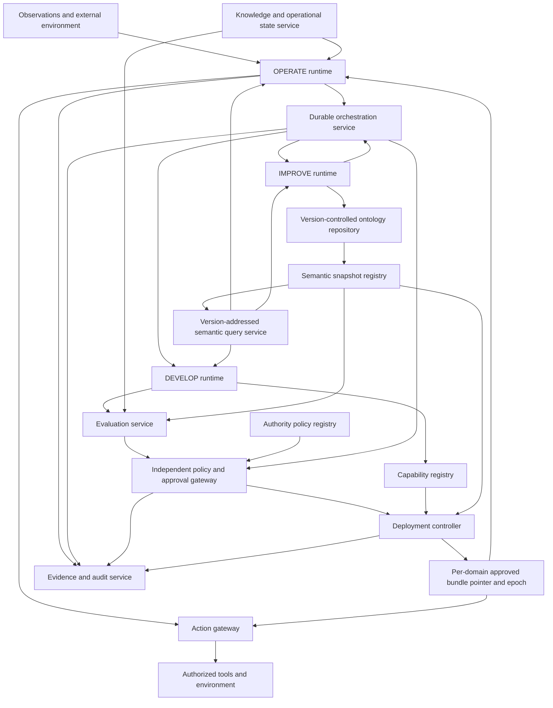

# Reference components and consistency scope

This is a proposed architecture. The components and contracts describe obligations for a future implementation; they are not evidence that an implementation exists or that its properties have been measured.

DEVELOP, OPERATE, and IMPROVE are lifecycle responsibilities. Each may be realized by services, people, workflows, agent teams, or combinations of these. The orchestrator is the reliable coordination and enforcement arrangement around those responsibilities, rather than necessarily one language model.

## A. Component architecture

| Component | Responsibility | Required boundary |
|---|---|---|
| Durable orchestration service | Maintain proposal state; issue bounded work; correlate evidence, evaluations, approval and deployment | Agents return outputs as evidence; an output is not itself a transition authorization |
| Ontology repository | Store candidate roots, import locks, shapes and semantic change descriptions | Branches do not become operational authority because they exist in Git |
| Semantic snapshot registry | Resolve complete, immutable semantic snapshots by content digest | Freeze imported bytes, shapes, reasoner implementation/configuration, rules and mappings |
| Semantic query service | Provide relevant projections of an identified snapshot | Every answer identifies snapshot digest, projection boundary, entailment mode and completeness qualifications |
| Knowledge and state service | Hold assertions, operational records, state schemas and migration checkpoints | Facts and state do not silently alter schema, policy or deployment authority |
| Capability registry | Store executable artifacts and dependency declarations | No mutable alias such as `latest` at an execution boundary |
| Evaluation service | Produce scoped evidence of checks against a candidate bundle | Evidence records test inputs, semantic snapshot, evaluator build and limitations |
| Policy and approval gateway | Evaluate authority effects and issue scoped, expiring authorizations | Evaluator configuration and approval rules are governed independently of the candidate |
| Deployment controller | Stage artifacts, prepare state, commit bundle pointer, fence old workers | Deployment requires an approval for the exact bundle digest and domain |
| Action gateway | Check caller, domain, active epoch, action and semantic policy context at consequential execution | Agents cannot bypass this gate through ambient credentials |
| Observability and audit service | Preserve decision provenance, events, evidence references and outcomes | Audit retention/access controls are part of governance; a hash cannot restore missing evidence |

## Shared semantics, separated stores

The ontology provides concepts, relations and logical axioms. Shapes describe conditions imposed on particular RDF graphs. The knowledge base provides assertions about entities. Operational state records the progress and effects of workflows. Observations are inputs before or during interpretation; evidence supports claims about them. Policies determine permissions and obligations. Capabilities implement behavior. A deployment bundle binds these artifacts without pretending they are one interchangeable knowledge graph.

An observation may be stored before it can be classified. Use raw payloads and evidence references with provenance, privacy controls and a provisional status; do not force a new observation into an authoritative category merely to fit the schema.

RDF and OWL can express relationships more general than trees. OWL import closure matters because imported axioms contribute to the ontology's semantics. [OWL 2 structural specification](https://www.w3.org/TR/owl-syntax/) SHACL separately validates a data graph against a shapes graph; the selected input graphs must remain stable during validation. [SHACL recommendation](https://www.w3.org/TR/shacl/)

## Domain-scoped consistency

A **domain** is an explicitly governed consistency scope, such as one simulation world, course, facility, or tenant. For each domain `d`, the authoritative deployment record is:

`P_d = (bundle_digest, deployment_epoch, state_epoch, lifecycle_revision)`.

The architecture requires atomic commitment of this record within the domain. It does not require every system, organization, or domain to share one globally synchronized ontology. Different domains may remain on different approved bundles. An agent cannot combine answers from those domains as though they had one semantic snapshot.

Queries include `domain_id`, `bundle_digest`, `semantic_snapshot_digest`, and, where facts matter, `knowledge_snapshot_id` or a declared consistency mode. Cached answers retain these identifiers. A semantic projection may be sufficient for a task, but it is not presumed closed under every inference. If an action depends on an inference outside the projection, the service must obtain the required closure or decline to certify it. Projection tests and dependency declarations are therefore part of the gate's evidence.

Cross-domain operations require an explicit compatibility agreement describing shared vocabulary, mappings, identity correspondence, state consistency and authority. Unknown compatibility causes suspension or escalation under the configured policy. A globally atomic multi-domain deployment is outside the base design; a deployment requiring it needs an additional coordination protocol and failure analysis.

The control record and action authorization need stronger consistency than the audit and telemetry views. Eventual telemetry is acceptable when it does not make deployment or permission decisions. A disconnected worker may continue preparatory reasoning under a cached snapshot; consequential actions require a currently valid epoch or a previously issued bounded lease whose expiry and scope are checked by the receiving resource.

## Practical technology choices

Choose an ontology language and reasoning profile from the needs of the domain. A relational schema with controlled vocabularies may be adequate for a small deployment; OWL is not a prerequisite for the lifecycle model. If OWL is used, identify the supported profile and reasoner rather than promising unrestricted semantic checking.

RDF stores such as Apache Jena, GraphDB and Stardog are candidate storage/query infrastructure. WebProtégé is a candidate collaborative authoring interface. Their presence does not establish immutable imports, complete change impact analysis, approval independence or fenced execution; these remain explicit architecture obligations. Git records reviewed files and provenance, while a registry freezes the resolved semantic environment. A durable workflow engine can recover coordination state from recorded events; LLM calls and external effects remain separate activities with recorded results and idempotency arrangements. [Temporal event history documentation](https://docs.temporal.io/encyclopedia/event-history)

No product is selected or benchmarked in this proposal. Tool selection requires a prototype that measures reasoning cost, import handling, validation scope, durable recovery and enforcement under the chosen failure model.
