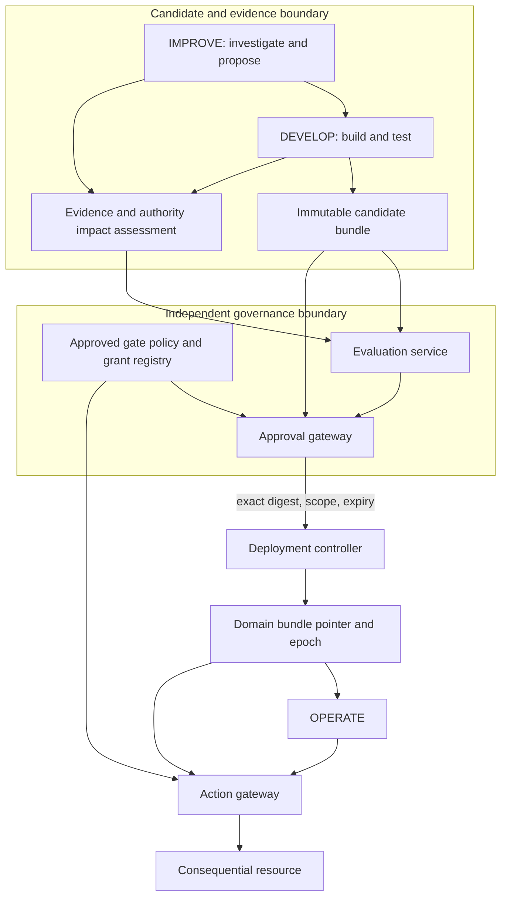

# Authority, approval and deployment

The governance objective is controlled lifecycle evolution. Agents may suggest and implement changes without thereby acquiring authority to approve those changes, rewrite their approval rules, or issue production actions outside their existing grants.

## Governing interpretation and scope

Authentication and resource authorization remain necessary. This contract also requires governance of the interpretation used to select and justify an action:

- Semantic and ontological scope identifies the approved vocabulary, relationships, mappings, and inference configuration for the domain.
- Epistemic scope identifies applicable domains, admissible evidence, claim-admission requirements, and the handling of uncertainty. A generated hypothesis is not automatically an approved decision input.
- Task and action scope identifies delegated purposes, named systems and targets, permitted effects, budgets, and approval conditions.

Bind these constraints to identified instructions, snapshots, evidence policies, grants, and evaluation artifacts. Treat proposed extensions as candidate changes and assess their authority consequences independently. Additional diagnostic relevance does not grant additional intervention authority. Enforce the resulting boundary at the receiving resource; prompts and ontology labels alone cannot contain an overprivileged tool.

This is complementary governance, not a claim that established security research ignores context or task purpose. See the paper's section "Governance beyond identity, access control, and workflow" for the comparison with NIST zero trust and ABAC, BPMN, the AI RMF, OWASP excessive-agency guidance, and Task Shield.

## Responsibilities and credentials

| Responsibility | Permitted by default in this model | Independently governed boundary |
|---|---|---|
| OPERATE | Perform delegated work, retain observations, report mismatches, suspend affected work | Cannot publish authoritative ontology/policy or deploy capabilities |
| IMPROVE | Investigate within granted evidence/tool scope; propose semantic and procedural changes | Cannot promote its branch or change the gate policy |
| DEVELOP | Build/test exact candidates in isolated environments; propose migrations and recovery artifacts | Cannot issue production deployment approval or use production action credentials |
| Orchestration workflow | Schedule bounded activities; maintain durable state; request evaluations/approval | Cannot treat a generated rationale as an approval or change an evaluator's trust basis |
| Approval gateway | Apply independently approved gate rules; authorize exact bundles, domains and effects | Candidate-controlled content cannot modify its evaluators, grants or trust roots |
| Deployment controller | Stage and activate approved artifacts using conditional pointer updates | Requires valid exact-bundle approval and compatible state |
| Action gateway/resource | Enforce principal, action scope, epoch/lease and matching semantic policy | Rejects ambient or stale authority; logs uncertain effects for reconciliation |

One organization can house all these services, and low-risk deployments may use preapproved automatic gates. Independence here means separation of credentials, code/configuration ownership, authorization rules and enforcement paths sufficient to prevent the candidate from authorizing itself. It is not satisfied by asking a second prompt in the same privileged agent process. Human review is one approval mode, not the only one.

## F. Authority and approval boundaries



The trust boundary must hold even if generated proposals, evidence documents or ontology annotations contain instructions attempting to influence the evaluator. Treat candidate material as data. Verification services parse structured inputs, restrict tool/network access, and do not execute candidate-authored approval code without an independently governed evaluator update.

## Automatic promotion policy

A preapproved rule may allow automatic promotion only when its stated conditions hold, for example: candidate impact is restricted to an enumerated domain; no inferred expansion of action/target scope is detected within the declared bounded profile; existing invariants remain satisfied; all dependent capabilities and policies have sufficient evidence; migration is compatible and recoverable; candidate budget and change size are bounded; approvals and dependency locks are valid; and undecided checks fall within explicit tolerances.

These conditions do not prove universal safety. Their risk acceptance and coverage belong to the approving authority. A rule that treats every additive ontology change as harmless is insufficient because additive entailments can expand permissions. A rule that allows new target categories solely because tests pass conflates observed outcomes with authority to act on that category.

Approval binds proposal revision, bundle digest, domain, expected base digest/control revision, evaluation references, gate-policy digest, effective-authority findings, authorized grants, expiry and approver identity. A signed receipt is one possible implementation; authenticated registry records are another. The action gateway verifies independently issued grants rather than trusting the candidate's claim that approval occurred.

Budget investigation, build cost, recursive proposal depth and deployment rate. Repeated novelty reports can be deduplicated or grouped while keeping distinct evidence. A change to budget ceilings, evaluator scope, credential access or promotion rules is itself a governance change requiring authority outside the candidate's control.

## Authority through semantic closure

Let a routing rule select `Machine(x)` for a single-machine reset, while an independently controlled policy requires authorization for every affected asset. An ontology/rule update can enlarge routing eligibility under unchanged rules. If permission depends on category membership and no other gate excludes a newly eligible invocation, effective authorization can also expand. In the maintenance example, the independent guard blocks a reset when the impact or authority for a shared controller and coupled machines remains unresolved. A grant for coordinated diagnostic reads does not grant intervention authority. Imported ontologies, mappings, identity equivalence, subclass axioms, tool adapters and data transformations can all influence the interpretation that reaches a policy decision.

Assess the **effective** authority delta using the full semantic configuration and bounded candidate cases, including previously denied targets and newly inferred memberships. Compare `A(B0,U)` with `A(B1,U)` and record additions, removals and undecided cases. New permissions require an independently approved grant; unknown cases require the configured conservative disposition. A fixed grant expressed only in the same mutable predicate can suffer the same drift. High-consequence grants may therefore need pinned semantic predicates, explicit target identifiers or independently controlled applicability conditions.

This lifecycle paper introduces the boundary and supplies interface hooks. A comprehensive theory of authority bounds and revocation is deferred to the proposed companion paper *Bounded Agency*. No universal, complete authority-delta algorithm is asserted.

## E. Deployment and recovery

```mermaid
sequenceDiagram
  participant G as Approval gateway
  participant D as Deployment controller
  participant S as State service
  participant P as Domain pointer store
  participant R as OPERATE workers
  participant A as Action gateway
  G-->>D: Approval for exact B1, domain and base B0
  D->>D: Resolve and verify all artifact digests
  D->>S: Prepare compatible state checkpoint
  S-->>D: Prepared state epoch and migration evidence
  D->>R: Stage B1 and acknowledge readiness
  D->>P: CAS B0/revision to B1 with epoch e+1
  P-->>D: Committed deployment record
  D->>A: Notify pointer change for cache invalidation
  D->>R: Activate B1; drain or fence B0 workers
  R->>A: Action with B1, semantic digest and epoch e+1
  A->>P: Verify authoritative active binding at action time
  P-->>A: Active bundle and epoch
  A->>S: Revalidate critical fact eligibility or reservation
  S-->>A: Freshness and state revision receipt
  A-->>R: Permit only matching active context
  Note over D,S: Failure triggers compatible recovery assessment
  D->>G: Request recovery approval for B0 or repair bundle
  G-->>D: Recovery grant or refusal
  D->>S: Establish compatible recovery state
  D->>P: CAS to recovery bundle with epoch e+2
  D->>A: Notify recovery; every action still verifies active epoch
```

The controller does not need simultaneous worker replacement. Old and new workers may coexist physically during staging/draining, but only the active bundle epoch can issue consequential actions in the domain under the base protocol. If both versions must act during a rolling migration, define separate compatibility scopes or an explicitly approved coexistence protocol; the simple invariant must not be assumed to cover mixed-version activity.

The pointer store, state service and action gateways must agree on freshness. One possible protocol blocks affected actions while the prepared state/pointer transition commits. Another uses resource-enforced leases with bounded expiry and waits for earlier leases before activation. A cached pointer plus an unexpired unrestricted credential does not fence old workers. A partitioned gateway must fail closed for new consequential actions when it cannot validate the required freshness, unless the governance design explicitly issued a bounded offline lease.

Notifications improve propagation but are not the correctness mechanism. In the epoch-checked mode shown, every consequential action reads/verifies the authoritative active binding; a stale cache cannot permit an old epoch. The resource also verifies critical facts transactionally or through a bounded reservation/lease. A compatible state schema does not imply that target eligibility has remained true since the agent's earlier read.

Recovery after an ambiguous side effect requires reconciliation with the receiving system; retry is not evidence that the first attempt failed. An old workflow may resume only after its persisted records are compatible with the recovery bundle. A repair bundle may be safer than returning to the old ontology. Epochs always advance, including on rollback, to prevent revived stale workers from regaining permission.
