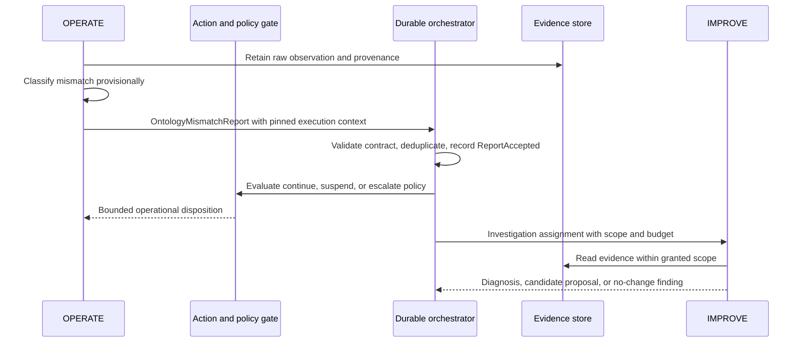
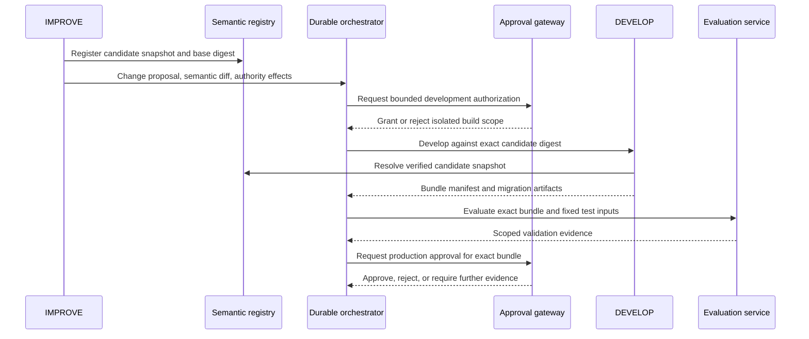

# Lifecycle state machine and conditional safety argument

This specification is a design model. Its invariants describe required behavior, and its argument is conditional on enforcement assumptions. No state machine implementation or formal model-checking result is claimed.

## Formal objects

Let `S` be an immutable semantic snapshot containing an ontology root, its resolved transitive imports, shapes, a language/entailment profile, a reasoner build and configuration, rules, and mappings. Let `K` be a versioned knowledge snapshot or identified operational read view. Let `B` be a bundle binding `S` to capabilities, tools, model specification, instructions, authority policy, evaluation suite, deployment configuration, state schema and migration plan. `digest(B)` addresses canonical manifest bytes; component digests address the retained artifacts. A cryptographic digest binds bytes, not their correctness.

`P_d=(digest(B), e, s, r)` identifies the approved bundle, monotone deployment epoch `e`, compatible state epoch `s`, and domain control revision `r` for domain `d`. A worker's execution context is `X=(d, digest(B), digest(S), e, s, principal, workflow_id)`. Trusted runtime records attest this context; an LLM cannot establish it merely by reporting the identifiers. The action gate authenticates the caller and validates the binding independently.

For an identified set of observations and facts `U`, define an effective authorization denotation:

`A(B,U) = { (principal, action, target, conditions) permitted by the policy in B when evaluated under S and U }`.

This is a useful abstraction, not a promise that the entire set is computable for every ontology or open environment. A change assessment evaluates a bounded `U`, semantic dependencies, and declared unknowns. Approval must not interpret unexamined cases as evidence of unchanged authority.

## States and guarded transitions

Each change has a stable `proposal_id`, immutable candidate revisions, and an append-only lifecycle history. Revisions do not overwrite already evaluated candidates. A domain can operate its current bundle while one or more proposals are investigated.

| From → to | Required guard | Recorded result |
|---|---|---|
| `REPORTED → INVESTIGATING` | Valid report, access scope and bounded investigation budget | Assigned scope, evidence references and base bundle |
| `INVESTIGATING → PROPOSED` | Candidate digest, semantic diff, rationale and impact/authority analysis present | Proposal revision; unknowns are explicit |
| `PROPOSED → BUILD_AUTHORIZED` | Independent authorization to use candidate in an isolated environment | Scope, budget, artifacts and expiry of development authorization |
| `BUILD_AUTHORIZED → BUILT` | Required capability and migration artifacts retained | Immutable complete bundle manifest |
| `BUILT → VALIDATING` | Evaluator and test-plan versions fixed | Evaluation run identifiers and input snapshots |
| `VALIDATING → VALIDATED` | Required checks completed with acceptable results; unresolved findings meet gate policy | Signed or authenticated validation evidence bound to exact bundle |
| `VALIDATED → APPROVED` | Approval gateway accepts evidence, authority assessment and current base/revision | Approval token bound to candidate, domain, gate-policy version and expiry |
| `APPROVED → STAGED` | All artifacts verified; deployment prerequisites and state preparation satisfied | Staging receipts, readiness and migration checkpoint |
| `STAGED → ACTIVE` | Approval remains valid; expected active bundle and revision still match; state compatibility verified | Atomic pointer commit with new epoch, followed by activation/fencing receipts |
| `ACTIVE → RETIRED` | Work drained or fenced; retention obligations satisfied | Historical bundle and successor link |
| `ACTIVE → ROLLBACK_PENDING` | Failure condition and authorized recovery plan | Incident, recovery candidate and state compatibility assessment |
| `ROLLBACK_PENDING → ACTIVE` | Recovery bundle approved; state compatibility established; pointer committed with a **new** epoch | Recovery deployment record; original side effects remain in history |
| Any nonterminal candidate → `REJECTED`, `WITHDRAWN`, or `SUPERSEDED` | Appropriate authorized decision with reason | Terminal candidate record; reruns require a new revision |

Failed or timed-out activities do not advance the state. Retrying work may append attempts, but never substitutes evidence for a different candidate digest. A failed stage may return to an approval/recovery path only through an explicit transition. A partially completed migration is a recovery condition, not successful deployment.

The transition service applies compare-and-swap on the expected lifecycle revision and active bundle. A change to the base while a branch is being evaluated requires rebase and renewed impact/evaluation/approval or an independently checked compatibility argument. Merely retaining a previous approval after replacing its candidate is invalid.

Immutable proposal revision numbers, mutable proposal lifecycle revisions and domain deployment control revisions are distinct counters. Approval's expected domain control revision guards activation; intermediate proposal/staging events do not themselves change the active domain pointer.

## B. OPERATE-to-IMPROVE handoff

Mismatch discovery is an uncertain diagnosis. A missing fact or new instance need not cause an ontology branch. Even when suspension is necessary, unrelated work can continue within the existing authority envelope and consistency scope.

## C. IMPROVE-to-DEVELOP handoff

Development authorization grants access to an isolated build/test context. It is not production promotion approval. Test tools must not possess production credentials merely because they share a connector type with an operational capability.

## Durable coordination

Record accepted commands, activity scheduling/results, evidence references, candidate digests, approval outcomes and deployment decisions in a durable ordered history. Deterministic transition logic consumes this history. Agents perform uncertain reasoning outside that logic and return recorded outputs. Replaying coordination uses stored results rather than asking a language model to reproduce an old answer. This distinction follows established durable workflow practice. [Temporal event history](https://docs.temporal.io/encyclopedia/event-history)

Use a transactional outbox, or an equivalently reliable mechanism, when a control update and outbound message must agree. A message carries a stable event ID, correlation/causation IDs, expected revision and idempotency key. Consumers deduplicate. Delivery may be at least once; exactly-once external effects are not assumed. The resource receiving an action must implement idempotency or the controller must reconcile an ambiguous outcome before retrying. Compensating actions are separate authorized effects.

## Required invariants

1. **Immutable binding:** an approved bundle digest resolves to the same retained bytes and full semantic configuration for its retention period.
2. **Proposal isolation:** IMPROVE and DEVELOP cannot alter the domain's production pointer, production policy or action credentials through proposal/build interfaces.
3. **Exact approval:** deployment approval binds the domain, candidate digest, base precondition, evaluator evidence, gate-policy digest, expiry and authorized authority effects.
4. **Execution coherence:** an accepted consequential action uses one bundle and semantic snapshot with a compatible state epoch; it does not mix ontology, policy or capability versions from different bundles.
5. **Freshness fencing:** an action gateway rejects expired or superseded epochs; rollback advances the epoch and does not revive a stale worker's lease.
6. **Authority containment:** an authority expansion requires a separate authorized grant under governance outside the candidate's control. Expansion is assessed through semantic consequences, not only policy text.
7. **Evidence binding:** evaluation and migration evidence identifies exact artifacts and input states. Changed artifacts invalidate the evidence unless explicitly covered by its validity conditions.
8. **Recoverable transitions:** failures leave a recorded state from which the authorized recovery path is known; no unrecorded agent output activates a bundle.
9. **Provenance and freshness:** accepted actions record attested execution context, authenticated principal, actual input/evidence read views and state revisions, policy decision, action-time critical fact revalidation/reservation, idempotency key and observed outcome or explicit uncertainty. State-schema compatibility does not establish fresh fact eligibility.

## Conditional argument

Assume authenticated principals cannot bypass independently controlled registries, approval services and action gateways; runtime bindings are independently verified; digests are collision resistant and artifacts retained; the domain control record supports atomic conditional updates; state compatibility checks are sound for their specified scope; the gate correctly enforces an independently approved policy with execution-time critical fact checks/reservations; and all consequential resources enforce epochs/leases and idempotency or reconciliation.

Initially let the domain run a coherent approved bundle. Candidate-only transitions leave `P_d` unchanged. The guarded activation transition changes the complete bundle pointer and compatible state epoch in one conditional commit, and only for an approved digest. A worker executes under one identified context. At the action boundary the gateway either recognizes that context as active/valid and evaluates the matching policy, or rejects it. Consequently the transition model excludes an **accepted** consequential action under an unapproved or mixed semantic configuration, under those assumptions. Recovery uses the same guarded mechanism with a higher epoch.

This is a design-level inductive argument, not a mechanized proof. It says nothing by itself about whether the ontology adequately models reality, whether evaluation covers all behavior, or whether an authorized action is beneficial. If semantic impact analysis misses an expansion, the gate can approve an unsafe change despite coherent version binding. Compromised enforcement, unmanaged credentials, live mutable imports, invalid migrations and nonparticipating external resources invalidate assumptions.

Liveness is separate: independent approval, network availability, reasoning termination, artifact retention and compatible state recovery are needed for progress. Suspension preserves a defined boundary but may interrupt service. The proposal makes no universal availability guarantee during partitions or failed migrations.
