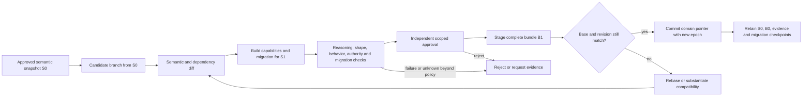

# Versioned semantic contracts and controlled evolution

A semantic contract is the **identified operating interpretation** against which a capability and its policy are evaluated. It is not a guarantee of a complete world model, a deterministic model output, or a mathematically comprehensive compatibility decision.

## What is versioned

Pin the ontology root and every transitive import by artifact digest. An import IRI is a logical or retrieval identifier; it does not by itself freeze the document that a remote server later returns. Record an import lock mapping each logical IRI to retained content, and disable unresolved network retrieval during evaluation and approved execution. OWL defines the import closure to include the ontology and all imported ontologies. [OWL 2 structural specification](https://www.w3.org/TR/owl-syntax/)

Also pin shapes and their imports, rule sets, mappings, the reasoner executable/build or container, reasoning configuration, entailment regime, supported language profile, materialization strategy and semantic query adapter. SHACL checks use identified shapes and data graphs; its result depends on those inputs and the supported constraint/entailment features. A conformance report is not evidence of every semantic or behavioral property. [SHACL recommendation](https://www.w3.org/TR/shacl/)

The snapshot digest addresses a canonical manifest of those retained artifacts. A Git commit is useful provenance but insufficient if its build resolves mutable dependencies. RDF blank node identifiers and serialization order can produce byte differences without logical change; if graph canonicalization is used, record its algorithm and version and distinguish its digest from raw file digests. No canonicalization algorithm is mandated here. A logical equivalence claim requires an additional specified semantic analysis.

Knowledge snapshots are separately identified. A semantic snapshot remains immutable while facts evolve. Operational decisions record the actual knowledge read view or snapshot, freshness policy, and any subsequent facts that affect a side effect. A historical knowledge snapshot can be much larger than the ontology and may require retention/redaction rules of its own.

## D. Branch and promotion lifecycle

Branch names and semantic version numbers communicate intent. Content digests identify the actual candidate. An additive axiom is not necessarily backward compatible: it can change entailments, shape targeting, policy scope and which entities reach a procedure. Compatibility must be stated relative to explicit dependent queries, policies, capabilities, datasets, state schemas and declared domain assumptions.

## Semantic diff and compatibility obligations

The proposal reports at least:

- Added, removed and changed axioms/shapes/rules/mappings, import changes, and profile/reasoner changes.
- Changes in inferred membership, relation entailments, consistency/satisfiability findings and selected query answers over retained test datasets.
- Changed shape targets, new or removed validation outcomes, and known open-world/closed-world assumptions.
- Dependent capabilities, policy predicates, tool routing, data transformations and migration effects.
- Effective authorization increases, decreases and undecided cases; required independent grants for increases.
- New observations that motivated the distinction; alternative explanations and why they were insufficient.
- Compatibility claims, scope of evidence, unresolved cases and operational disposition.

Dependency declarations are helpful but fallible. Impact analysis should combine declared dependencies with observed query/capability usage, graph/rule dependencies and adversarial cases. A capability using the broad category `ReturnItem` depends on new subtypes and membership entailments even when the identifier `ReturnItem` is unchanged. An inference can also remove an authorization under nonmonotonic application rules, even if the underlying OWL axioms are monotonic. Policy evaluation semantics must therefore be included in the analysis.

A future implementation should use a bounded profile in which required checks terminate within operational budgets, or conservatively mark unresolved results. OWL offers different profiles with different expressivity and computational properties; unrestricted reasoning should not be presumed practical or complete. [OWL 2 overview](https://www.w3.org/TR/owl-overview/)

## Bundle manifest

The reproducible bundle contains semantic snapshot, capability artifacts, source provenance, tool schemas/adapters, model-provider specification, prompts/instructions, authority policy, evaluator/test-plan artifacts, deployment configuration, state schema and migration/recovery plan. Models supplied by a provider may lack retrievable weights or lasting access to an old version. Record that limitation explicitly; a manifest can reproduce configuration without reproducing outputs or restoring an unavailable model. Tool and environment state can also evolve outside the bundle.

Validation evidence records both the candidate manifest digest and the exact evaluation inputs/configuration. Staging verifies artifact digests and deployment prerequisites. Approvals apply to exact candidate manifests; a late prompt edit or reasoner upgrade requires a new bundle and assessment.

## Migration and rollback

Ontology changes may require changes to persisted entities, identifiers, inferred materializations, indexes, workflow records and state schemas. A migration plan defines source/target schemas, selected data population, transformations, conflict handling, validation, checkpoint strategy, ownership, downtime/dual-read behavior and recovery conditions. New interpretations must not rewrite original observations or erase their earlier provenance.

Expand-and-contract migration is an option when old/new formats can safely coexist. If they cannot, quiesce the affected domain, fence actions, prepare migrated state and atomically commit the new compatible state/bundle record. A prepared snapshot must not lose writes made by the old deployment: block those writes while migrating, or establish a versioned change-capture/catch-up protocol whose final state revision is checked before activation. Where the state store and control store cannot share one transaction, a deployment protocol must establish a durable prepared checkpoint and ensure actions remain blocked until compatible state is committed. The proposal's atomicity concerns **the authoritative execution binding**, not simultaneous physical replacement of every process.

Rollback means deploy a previously approved or separately approved recovery bundle against demonstrably compatible state under a **new** epoch. Reverting source files alone does not restore knowledge, external effects, lost information or old model access. A lossy transformation, irreversible action or new workflow record may require a forward repair, compensation or human intervention. A recovery plan must state when rollback is unavailable.

## Two counterexamples

**Mutable import.** The root ontology Git commit is unchanged, but `owl:imports` resolves to a revised remote document. A new subclass entailment changes action eligibility. The root hash no longer identifies the operating semantics. Full closure locking and retained imported content are required.

**Additive subtype.** In a constructed warehouse scenario, the ordinary-return workflow selects `ReturnItem` cases for dispatch preparation, but an independent company-policy clearance service blocks unassessed exceptions. A proposed `DamagedBatteryReturn ⊑ ReturnItem` axiom makes `ReturnItem(x)` derivable in a differential fixture containing only `DamagedBatteryReturn(x)`. This enlarges routing eligibility without changing policy text; it does not supply handling clearance or make the dispatch permissible. An observed device already classified as `ReturnItem` would not acquire that classification for the first time, so the separate fixture isolates the entailment change. A text diff and valid RDF/SHACL parse do not establish behavioral or authority compatibility. The gate must examine the dispatch capability's assumptions and effective permissions. The revised candidate introduces `HandlingAssessment` and an assessment relation, routes the exception to designated specialist review, and holds dispatch pending explicit clearance. This example assumes a company-defined policy rather than describing a real handling procedure.
