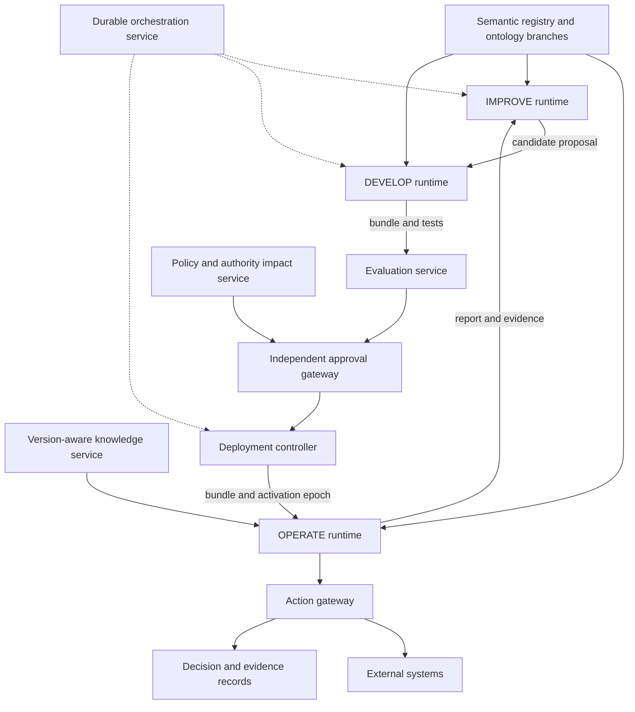

# Introduction

An agent that can complete a task is not necessarily a system that can maintain the capability to complete that task over time. Procedures become inadequate, observations challenge existing categories, tools change, and the interpretation of a policy may shift when its vocabulary changes. Continuous operation therefore creates a second problem: how to evolve the system without making its operating assumptions untraceable or allowing its effective authority to expand silently.

Consider a courier in a fantasy library. It transports objects classified as library artifacts. A newly encountered lantern speaks, chooses its destination, and objects to being packed. The courier's model distinguishes artifacts, rooms, and transport procedures, but contains no category for an artifact with preferences. Calling the encounter simply a failed tool call misses the representational problem. Allowing the courier to invent and adopt a new authoritative category during the same task risks changing the meaning of its permissions. Freezing the model indefinitely leaves the system unable to learn from recurring encounters.

The research question is: **Can autonomous software systems be organized into distinct development, operation, and improvement functions, coordinated through a shared, versioned ontology, to support continuous evolution while preserving semantic consistency, configuration reproducibility, and controlled authority?** This paper gives a reference architecture and a qualified answer: such a separation can specify enforceable release and action boundaries, provided that the semantic dependencies are actually pinned and the boundaries are mediated by trusted services. It cannot ensure that the model describes the world correctly or that an agent recognizes every unfamiliar situation.

We call the three functions DEVELOP, OPERATE, and IMPROVE. OPERATE performs delegated work using approved capabilities. IMPROVE investigates deficiencies and proposes changes. DEVELOP implements and tests executable capabilities against an identified semantic snapshot. An orchestrator coordinates their transitions and invokes independent release controls. These are responsibilities, not a requirement to run exactly three language models.

The paper makes four contributions as an architectural synthesis:

1. A deployment contract binding semantics, capabilities, authority, evaluation, and state compatibility into an immutable operating bundle.
2. A lifecycle in which evidence can challenge production semantics through an explicit report, candidate branch, implementation, validation, and promotion sequence.
3. A semantic impact obligation that includes changes in policy denotation and capability applicability, even when policy and capability source files are unchanged.
4. A distributed deployment contract connecting approval to an exact bundle, an activation epoch, compatible state, and action-time enforcement.

The contribution lies in specifying how established mechanisms interact for delegated agentic work: what each transition binds, which authority approves it, and which obligations remain at the point of action. The following sections relate this contract to its architectural foundations and define how its practical value could be tested.

# Positioning and research method

## Prior architectural foundations

Autonomic computing already treats systems as entities that monitor and adapt their own operation. MAPE-K separates monitoring, analysis, planning, execution, and shared knowledge. DEVELOP/OPERATE/IMPROVE does not replace that control model: OPERATE belongs largely to the managed application; IMPROVE groups analysis and planning; DEVELOP supplies artifacts used in adaptation; orchestration coordinates execution and release. The mapping is many-to-many because monitoring and knowledge management cut across the functions. [Kephart and Chess (2003)](https://doi.org/10.1109/MC.2003.1160055).

IBM's architectural blueprint also discusses orchestrated managers, policy-based delegation, composed management functions, and shared knowledge with common syntax and semantics. These provide the foundation for treating coordination and semantic interpretation as shared management responsibilities. [IBM (2005)](https://users.cs.fiu.edu/~sadjadi/Teaching/Autonomic%20Grid%20Computing/CIS-6612-Summer-2006/AC-Blueprint-WhitePaper-V7.pdf).

Architecture-based adaptation and models maintained during execution are also established. Rainbow uses an external architecture-based adaptation framework, while models@run.time addresses causally connected models that guide executing systems. They establish the use of an explicit runtime model and a separate adaptation layer. [Garlan et al. (2004)](https://www.cs.cmu.edu/~able/publications/computer04/); [Blair, Bencomo, and France (2009)](https://doi.org/10.1109/MC.2009.326).

Ontology evolution research has long examined changes, consistency, dependent artifacts, and propagation. Git-backed RDF version control is likewise established. These sources motivate treating an ontology branch as an engineering artifact whose dependencies and propagation effects require review. [Stojanovic et al. (2002)](https://doi.org/10.1007/3-540-45810-7_27); [Arndt et al. (2019)](https://arxiv.org/abs/1805.03721).

The connection between semantic evolution and security is also older than agentic software. Peldszus and colleagues describe semantic change detection, co-evolution proposals, and security compliance analysis. Our emphasis on authority affected by meaning changes is therefore an application and integration of an existing concern. [Peldszus et al. (2021)](https://doi.org/10.1016/j.datak.2021.101907).

## Closest contemporary comparisons

Three recent systems provide particularly close comparisons. Declarative Lifecycle Management for Self-Adaptive Systems connects semantic lifecycle descriptions to reconfiguration of managing-system components. EvoOntology maintains a versioned schema/content/tool ontology layer, uses operational trajectories to propose localized changes, and rejects candidates that fail paired evaluation. Governed Capability Evolution specifies compatibility checks and staged admission, monitoring, withdrawal, and audit for versioned AI components. [Kamburjan et al. (2026)](https://doi.org/10.1007/s10270-026-01358-w); [Chong et al. (2026)](https://arxiv.org/abs/2609.15779v1); [Qin et al. (2026)](https://arxiv.org/abs/2604.08059v6).

Further close comparisons include ontology-aware scientific tool acquisition, a bounded-autonomy workflow framework connecting semantic, evidential, procedural, and authority contracts, and versioned semantic evaluation records. [Tang et al. (2026)](https://arxiv.org/abs/2607.28692v1); [Jørgensen and Ma (2026)](https://doi.org/10.3390/info17090923); [Bousetouane (2026)](https://arxiv.org/abs/2610.07675v1). The last two were screened through primary abstract or indexed publisher content, so detailed absence claims are not justified.

| Comparator | Direct overlap | Focus of this reference contract |
|---|---|---|
| Declarative Lifecycle Management | Semantic stages and architectural adaptation | Complete release and action binding during model changes |
| EvoOntology | Versioned schema/content/tools and evidence-based evolution | Import closure, authority consequences, state and activation contracts |
| Governed Capability Evolution | Policy/behavior/recovery compatibility and staged deployment | Semantic dependencies as part of the same governed candidate |
| Bounded-Autonomy Framework | Ontology, context, process, and delegated authority contracts | Explicit ontology branch and distributed promotion obligations |
| EIO-Agents | Versioned evidence meaning and reconstructable evaluation | Operational action records connected to release identity |

Table: Scope of the reference contract in relation to close contemporary systems.

Table 1 identifies shared mechanisms and the focus of the present specification. Its final column describes design scope; it does not establish that a comparator lacks those features. This paper combines semantic dependency closure, authority consequences, and distributed action admission in a common release contract. The targeted search does not establish priority for that composition.

GitOps supplies a complementary release discipline: declarative desired state, immutable version history, automated reconciliation, and continuous convergence. Software supply-chain provenance contributes artifact lineage and build attestations. Adding an ontology hash to those practices is insufficient when imports, inference configuration, or policy interpretation remain mutable. [OpenGitOps principles](https://opengitops.dev/); [SLSA provenance](https://slsa.dev/spec/v1.0/provenance).

## Design method and literature search

The design proceeds in five steps: decompose the lifecycle into responsibilities and trust boundaries; compare those responsibilities with prior architectures; define release identities and transition contracts; challenge the contracts with semantic-change and stale-worker counterexamples; and derive conditional invariants with falsifiable evaluation criteria. The resulting artifacts are a reference architecture, illustrative interface schemas, and an evaluation design. Literature comparisons establish the design context; the examples and invariant argument provide analytical assessment. They do not substitute for an implementation study.

The supplementary search log records 43 primary discovery queries and nine additional queries submitted on 9 October 2026, sources inspected, access limitations, and a claim-by-claim assessment. Searches covered autonomic computing, ontology evolution, runtime models, knowledge-graph versioning, self-evolving agents, lifecycle governance, and semantic security impact. Close matches were sought deliberately. Foundational studies and recent agent preprints were compared by architectural feature rather than by terminology alone.

This is a targeted adversarial literature study, not a systematic review with a registered protocol, comprehensive database coverage, or an exhaustive patent search. Search indexing, inaccessible full texts, rapidly revised preprints, and differences between terminology and implementation limit coverage. A feature not observed in an inspected description is recorded as unestablished, not absent. The novelty assessment concludes that the broad thesis is anticipated and that originality of the integrated reference contract remains unestablished. The paper can be evaluated as a design contribution without converting that uncertainty into a claim of discovery.

# Semantic foundations and problem boundaries

## Distinct artifacts

An **ontology** describes concepts, entity kinds, relations, and applicable axioms. It can be a graph or logical theory; it need not be a tree. A **knowledge base** holds assertions about entities under that vocabulary. **Operational state** records workflow progress, pending actions, leases, and deployed versions. **Observations** are incoming measurements or reports, potentially incomplete or false. **Evidence** preserves sources, retrieval context, and support for claims. **Policies** determine permitted actions and approval conditions. **Capabilities** are executable procedures or services.

These distinctions concern responsibility and meaning, not physical storage. An RDF store may hold both domain definitions and case facts in different named graphs. A policy can refer to ontology terms without being owned by the process that edits those terms. A statement produced by an LLM can be preserved as a hypothesis without being inserted as an approved fact. An ontology can represent concepts of evidence or authority while records of particular evidence or authority grants remain separate artifacts.

Fact admission also requires controls. An agent that cannot edit the ontology may still change effective permissions by asserting a decision-bearing classification or relationship. The knowledge service therefore authenticates writes, preserves supporting evidence, separates provisional from approved assertions, and applies policy-specific freshness and conflict rules. Routine fact updates need not become ontology releases, but they cannot bypass the evidence requirements for consequential decisions.

The library model might define `Artifact`, `Room`, and `locatedIn`. The assertion that lantern L17 is in the east archive is a case fact. A camera image is an observation and evidence object. The permission to relocate approved artifacts is policy. The packing routine is a capability. A courier's paused workflow is operational state. Collapsing these into one mutable agent memory would make it difficult to distinguish a new observation from an approved change in meaning.

## A semantic snapshot includes its interpretation

Let an identified semantic snapshot be

$$S=(O,I,H,R,M),$$

where $O$ is the ontology root; $I$ is its transitive, pinned import closure; $H$ is a set of validation shapes; $R$ identifies the entailment regime, reasoner implementation, and configuration; and $M$ contains additional rules, mappings, units, and interpretation conventions needed by consumers. The registry resolves this tuple to immutable bytes and a manifest digest $h_S$. A Git commit of $O$ alone does not identify $S$ if an imported URL resolves differently tomorrow.

A hash identifies bytes, not equivalence of meaning. Two serializations may encode equivalent axioms while producing different byte hashes. Conversely, an unchanged ontology file may yield different answers after a reasoner or mapping change. A reproducible packaging format must fix file identities, ordering, digest algorithms, and import resolution. RDF dataset canonicalization can normalize serialization differences and blank-node identifiers; it does not establish logical equivalence between different axiom sets. The canonicalization algorithm and configuration must themselves be identified. [W3C RDF Dataset Canonicalization](https://www.w3.org/TR/rdf-canon/).

OWL entailment and data validation answer different questions. Under open-world reasoning, missing assertions do not generally establish falsity. Some restrictions allow the existence of an unnamed value without showing a stored field is populated. SHACL checks graph conformance under specified targets, constraints, and an explicit entailment setup; conformance is not proof of domain truth. The bundle must state whether shapes examine asserted data, an inferred graph, or another declared view. Reasoner timeout, unsupported semantics, or unknown outcomes cannot be converted into a successful check. [W3C OWL 2 Direct Semantics](https://www.w3.org/TR/owl2-direct-semantics/); [W3C SHACL](https://www.w3.org/TR/shacl/).

## What counts as an unfamiliar situation?

The question "What happens when the system encounters something that cannot be represented by its current ontology?" has several answers. The first obligation is to distinguish causes, as summarized in Table 2.

| Discrepancy | Example | Initial disposition |
|---|---|---|
| Missing fact | The lantern's destination is unknown | Seek evidence within approved permissions |
| Unknown entity | A previously unseen lantern fits `Artifact` | Create a provisional case identity under admission rules |
| Contradictory evidence | Two sensors report incompatible locations | Preserve sources and investigate; do not overwrite the disagreement |
| Constraint violation | A required transport clearance is missing | Hold or reject the action under the declared validation policy |
| Procedure gap | Existing categories fit, but no safe workflow exists | Request a capability change without assuming an ontology change |
| Suspected conceptual gap | An artifact expresses preferences absent from the model | Report a model limitation and investigate a candidate distinction |

Table: Discrepancy classes and their initial operational dispositions.

An unusual value or a failed procedure is not by itself evidence of a missing concept. A suspected conceptual gap is a defeasible diagnosis: bad data, a poor mapping, ambiguous language, or an unavailable procedure can explain the same symptom. OPERATE can detect residual patterns, validation failures, unexplained tool outcomes, and uncertainty, but cannot reliably recognize everything outside its representational vocabulary. Free text and raw evidence therefore remain available alongside typed fields. Reporting channels must allow "unclassified" rather than forcing every challenge into the very categories under challenge.

# Lifecycle responsibilities and the operating bundle

## Three functions and one coordination responsibility

OPERATE accepts work, interprets observations under an approved $S$, invokes capabilities, and records outcomes. It may update permitted case facts and operational state. It cannot overwrite the authoritative semantic snapshot or obtain a release approval merely by declaring that a new interpretation is useful. Its response to uncertainty is configurable: continue unaffected work, invoke a bounded fallback, pause the affected case, or escalate.

IMPROVE investigates reports and recurring failures. It checks competing explanations, gathers permitted evidence, and proposes ontology, mapping, policy, capability, or evaluation changes. It can create a candidate branch and describe a provisional interpretation. Its credentials give it access to a proposal space, not the production reference. It may recommend no change or reject a misleading report.

DEVELOP builds and tests capabilities against a specific candidate snapshot. Its work order identifies $h_S$, expected interfaces, permitted development tools, budget, fixtures, and release criteria. If the candidate changes, its outputs and validation evidence must be reconsidered. A tool or prompt update is still a capability change even if no conventional source file changes.

The orchestrator maintains durable lifecycle state and delegates work. Independent services enforce promotion and operational authorization. The orchestrator can be a workflow engine plus supervisors, registries, and deployment controllers. Its reasoning assistant may recommend a transition, but the transition guard executes in a trusted service. Combining functions in one implementation is permitted only if the required credential, approval, and evidence boundaries remain enforced.

## Immutable release identity

Define an operating bundle

$$B=(S,C,T,L,U,P,E,D,X),$$

where $C$ identifies capability code and dependencies; $T$ tool interfaces and implementations; $L$ the model identity and declared runtime characteristics; $U$ prompts and instructions; $P$ authority policy; $E$ evaluations, fixtures, and thresholds; $D$ deployment configuration; and $X$ the operational-state schema and migration/compatibility plan. An immutable manifest gives the bundle digest $h_B$.

A hosted model alias is not an immutable model identity. If the provider cannot pin a version or supply weights and runtime details, the manifest records that limitation and the known provider revision rather than claiming a fully reconstructible bundle. Tool implementations and remote APIs can also change behind stable identifiers. The release contract must identify these mutable dependencies and the conditions under which their changes trigger review.

For consequential actions, the decision record includes $h_B$, the activation epoch, the task and observation references, the knowledge-base revision or query snapshot, retrieved semantic slices, policy decision, capability invocation, outputs, and external result. It records what is available, including omissions or redactions. Evidence access is governed separately so that provenance does not become a route to unrestricted disclosure.

This enables **configuration reproducibility** and, where input and state are preserved, **decision reconstruction**. It does not imply identical LLM outputs, repeated external effects, or deterministic replay. Identical configuration can coexist with stochastic decoding, provider changes, nondeterministic tools, and changing external state. A preserved action trace is evidence of an execution, not a promise that rerunning it will repeat the result.

# Reference architecture and transition contract

## Components and information paths

The reference architecture comprises a durable orchestration service; semantic and capability registries; a version-controlled ontology repository; a shared knowledge service; operational, improvement, and development runtimes; evaluation and policy services; an approval gateway; a deployment controller; an action gateway; and an audit/evidence service. Registries identify approved immutable artifacts. The shared knowledge service serves facts and queries under a specified semantic snapshot and data revision. Observation ingestion stores incoming evidence before interpretation.

Figure 1 shows responsibilities and enforcement paths. The architecture companion provides six additional diagrams detailing lifecycle handoffs, ontology branching, release identity, validation, and governance.

*Figure 1. Reference components. Candidate generation and production admission are separate paths. All consequential operational effects pass through the action gateway.*

The controller requires durable, idempotent transitions and recoverable scheduling. An event stream can distribute reports and status, but does not by itself provide a unique production reference or enforce approval. A workflow engine can retain lifecycle history, but external actions still need deduplication and reconciliation. Agent supervisors handle bounded tasks and timeouts. Combining these components is a deployment choice; their contract is the design requirement.

## Practical implementation choices

A small implementation could use Git-retained RDF/OWL files with import locks, an independently stored bundle registry, Apache Jena for RDF querying and declared validation/reasoning, and a durable workflow service. RDF supplies the graph representation; OWL supplies selected entailment semantics; SHACL supplies specified graph constraints. They are complementary roles, not interchangeable products. Jena's documented components include Fuseki, persistent stores, inference, and SHACL processing. [Apache Jena documentation](https://jena.apache.org/documentation/).

GraphDB and Stardog are alternative knowledge services with documented query and inference facilities. Their repository configuration, inference view, transaction behavior, and artifact export need to be assessed against the bundle contract; a product name does not establish immutable semantic snapshots or promotion independence. WebProtégé is a collaborative authoring option, while a Git-backed knowledge graph such as Quit Store addresses versioned collaboration. Neither an editor's revision history nor a database backup alone identifies the complete operational interpretation. [GraphDB documentation](https://graphdb.ontotext.com/documentation/11.5/); [Stardog documentation](https://docs.stardog.com/); [WebProtégé project](https://protege.stanford.edu/software.php); [Arndt et al. (2019)](https://arxiv.org/abs/1805.03721).

A durable workflow engine such as Temporal can coordinate long-running activities and retained execution history; an event-driven implementation is also possible if it explicitly supplies equivalent transition durability and reconciliation. The reference architecture requires deterministic transition guards around nondeterministic tasks. Workflow replay does not make an LLM deterministic, and deployment/action authority remains a separate enforcement obligation. These are implementation candidates, not a performance comparison or verified integration. [Temporal workflow execution documentation](https://docs.temporal.io/workflow-execution).

## State machine

Let a change request $q$ have a durable revision, parent bundle, candidate digest, evidence references, and lifecycle state. The supplied event schema defines `REPORTED`, `INVESTIGATING`, `PROPOSED`, `BUILD_AUTHORIZED`, `BUILT`, `VALIDATING`, `VALIDATED`, `APPROVED`, `STAGED`, `ACTIVE`, and `RETIRED`, with `REJECTED`, `WITHDRAWN`, `SUPERSEDED`, and `ROLLBACK_PENDING` for alternative paths. A no-change investigation closes as `WITHDRAWN`; an abandoned candidate revision becomes `SUPERSEDED`. Quarantine is an isolation disposition recorded with rejection. Withdrawing an active capability requires recovery or suspension and does not erase its deployment history.

Figure 2 groups related activities into a lifecycle overview. Monitoring occurs within `ACTIVE`; recovery enters `ROLLBACK_PENDING` and must select an approved compatible target. Build and validation each include the finer states defined above. The same path can support routine automated changes under previously approved rules.

*Figure 2. Lifecycle overview; boxes group the finer event-schema states. Each controlled transition retains a guard decision. Development authorization does not authorize deployment.*

| Transition | Required guard and record |
|---|---|
| Report to investigation | Admitted report, accessible evidence, budget and scope |
| Proposal to development | Fixed parent and candidate snapshot; authorized work order |
| Built to validated | Artifact integrity; declared syntax, semantics, behavior, authority, and state checks |
| Validated to approved | Independent approval over exact bundle and evidence digests; approved scope and expiry |
| Approved to staged | Deployment credentials; compatible state; verified worker artifacts |
| Staged to active | Compare-and-swap against expected production epoch; valid approval; action gateway fencing |
| Active to recovery | Trigger and evidence; authorized compatible target or suspension; external-effect reconciliation |

Table: Representative transition guards and required records.

Table 3 summarizes the main guards. Any artifact change invalidates approvals that bind its previous digest. A passing evaluation does not itself create an approval. Two candidate branches can proceed in parallel, but each is checked against its own parent. If production changes while a candidate is being built, it must be rebased or explicitly approved for the resulting version relationship. Semantic conflicts can exist even when a textual merge is clean.

## Handoff contracts

An `OntologyMismatchReport` binds observations and evidence to the operating bundle, semantic snapshot, trusted runtime context, knowledge read view, and state compatibility epoch. It records provisional discrepancy categories, affected concepts or procedures when known, operational consequence, chosen disposition, and any tentative hypothesis. The `unclassified` category permits a report before a modeled diagnosis exists; `constraint_violation` identifies a declared graph or operational requirement that failed. The report does not grant its author authority to amend production.

An `OntologyChangeProposal` identifies the parent snapshot, candidate, report references, typed changes, rationale, alternative explanations, affected dependents, asserted compatibility, authority impact, migration plan, and required tests. A claim such as "backward compatible" is an input to review rather than a trusted Boolean that skips it.

A `DevelopmentWorkOrder` binds the candidate snapshot to expected behavior, tooling, budget, tests, and the precise authority to build. An `OperatingBundleManifest` pins all release artifacts. A `LifecycleApproval` identifies the bundle, evaluation evidence, governance rule or named approver, scope, activation constraints, and expiry. A `DeploymentRecord` captures bundle activation and recovery. A `DecisionRecord` links accepted or rejected operational actions to their bundle, epoch, state, evidence, and authorization result. Typed JSON Schemas are supplied in the repository; implementations still need to enforce cross-field relationships and credentials.

All mutation APIs use request identities, expected revisions, and authenticated principals. Duplicate delivery must not duplicate a proposal, transition, or external effect. Payload schemas do not prove that evidence is true, that a signature is authentic, or that an emitter has the claimed role. Validation and authentication are separate obligations.

# Ontology evolution and semantic impact

## Branching and validation

IMPROVE creates a branch from an identified parent rather than modifying production in place. The branch contains proposed ontology axioms, shapes, import pins, mappings, and associated change rationale. Labels such as 1.4.2 and 1.5.0 assist communication; content digests identify actual artifacts. Semantic version numbers are declarations interpreted under a project compatibility policy, not proof of safe substitution.

Validation has several layers. Parsing and schema checks establish usable artifact structure. Logical checks address consistency or selected entailment obligations within a supported logic. Shape checks evaluate declared graph views. Behavioral regression tests exercise affected capabilities. Authority checks examine consequences for authorization. Migration checks assess state compatibility. Evaluation of a candidate must use the exact semantic snapshot and interpretation regime that it would deploy.

The dependency graph connects ontology terms and entailments to queries, classifications, mappings, policies, procedures, datasets, and evaluation fixtures. A semantic diff examines changes in derived conclusions and consumer assumptions, not only inserted triples. Adding a subclass can extend a rule's applicability. Changing a property's domain can introduce classifications through inference. Altering a unit mapping can invalidate a threshold without changing a class hierarchy. Removing a constraint may make a shape pass more cases while reducing the strength of its assurance.

A declared dependency graph can be incomplete, especially when prompts or dynamic queries refer to terms indirectly. Dynamic traces help identify used concepts but miss unexercised paths. Unknown dependencies trigger broader evaluation or a restricted rollout rather than an unsupported declaration of no impact. Semantic comparison depends on the selected logic, signature, and notion of equivalence; computational limits differ across description-logic profiles. The architecture therefore records the supported check and treats inconclusive outcomes as insufficient for automatic admission. [Botoeva et al. (2017)](https://doi.org/10.1007/978-3-319-49493-7_2).

## Authority can change while policy text stays fixed

Let $\Omega_d$ be a governance-defined set of fully specified invocations in domain $d$, identifying each operation, target, and parameter set independently of the candidate ontology. Let $\mathcal{E}(B,K,u)\subseteq\Omega_d$ be the invocations eligible under classification and procedure-routing rules, and let $A(B,K,u)\subseteq\mathcal{E}(B,K,u)$ be those admitted after the complete policy and action-gateway checks for principal $u$ and approved context $K$. A comparison across changed identifiers requires a pinned mapping into this common space.

Suppose a routing rule selects `relocate(x)` when `Artifact(x)` holds. For a fixture containing only `SentientArtifact(x)`, adding

$$\mathrm{SentientArtifact}\sqsubseteq\mathrm{Artifact}$$

makes `Artifact(x)` derivable and can enlarge $\mathcal{E}$ without changing the policy file. If no other gate excludes the new invocation, $A$ can also expand: $P'=P$ does not imply $A(B',K,u)=A(B,K,u)$. If an independent clearance rule rejects it, routing eligibility expands while the action remains inadmissible. The worked example below distinguishes these outcomes.

For automatically promoted changes intended to preserve an existing authority envelope $G(u)$, the release obligation is

$$\forall K\in\mathcal{K}_{\mathrm{approved}}:\quad A(B',K,u)\subseteq G(u).$$

Here $\mathcal{K}_{\mathrm{approved}}$ is a declared scope of contexts; $G(u)\subseteq\Omega_d$ is an authority envelope owned by the governance boundary, not defined solely by the candidate ontology. The envelope is an upper bound; contextual conditions may permit fewer actions. Where comparison with the parent is meaningful, the reviewer also considers $A(B',K,u)\smallsetminus A(B,K,u)$. Expanding that difference is not automatically wrong: an authority owner may authorize a legitimate extension. It is wrong to treat the extension as invisible.

Finite fixture comparisons detect examples, not containment for every future knowledge state. A restricted policy/ontology profile may permit static reasoning over symbolically described contexts. Otherwise the gate needs an explicit scope limitation, conservative rejection of unproven expansion, or an authorized decision that accepts identified uncertainty. Gate criteria and governing vocabulary must themselves be protected from edits by the candidate-producing functions. This obligation applies security co-evolution concerns to the joint semantic release contract; it is not a new theory of access control.

## Knowledge migration and rollback

Ontology evolution may require instance-data migration, reclassification, mapping repair, or quarantine of incompatible records. Migration artifacts bind source and target semantic snapshots, supported state schemas, preserved fields, data-loss conditions, and reconciliation procedures. Historical decisions remain interpreted under their historical bundle, even if current knowledge has migrated. A compatibility view can expose older records, but its semantics and limitations must also be pinned.

Rollback is a new controlled deployment of a compatible prior or repaired bundle at a higher activation epoch. It is not restoration of an earlier epoch value. If a migration was lossy or the world has changed, the old bundle may no longer be safe. External effects such as sending a parcel cannot be undone by restoring code. Recovery may require compensation, a forward repair, suspension, or human intervention. An approval includes the expected recovery route and evidence that it is feasible for the permitted scope, not an unconditional promise to reverse time.

# Distributed operation, governance, and assurance

## Activation and action-time checks

For each governed domain $d$, the authoritative production reference is

$$Q_d=(h_B,e,z),$$

where $e$ is a monotonically increasing activation epoch and $z$ identifies the compatible state epoch or schema relationship. The controller stages immutable artifacts, checks approvals and state prerequisites, and commits the reference with compare-and-swap against the expected previous reference. Conflicting controllers cannot both replace the same expected epoch successfully. Epoch-conditioned updates and recipient-side rejection of stale sequencers are established distributed-systems mechanisms; this architecture applies them to the complete semantic operating bundle. [Burrows (2006)](https://www.usenix.org/legacy/events/osdi06/tech/full_papers/burrows/burrows_html/index.html).

Workers verify and load a complete bundle. Each consequential invocation carries its domain, $h_B$, activation epoch, case-state revision, authenticated principal, and idempotency key. The action gateway compares those values to the authoritative admission rule before authorizing an effect. A stale worker with a perfectly valid old bundle is denied after its authority is revoked. Merely broadcasting "new ontology available" is insufficient because a partitioned worker can continue using cached semantics.

Logical atomicity applies to the admission boundary, not simultaneous replacement of every distributed process. The companion specifies a base protocol in which only the current bundle epoch admits consequential actions. Retained leases are an optional coexistence extension for rolling deployment: the gateway admits a named, independently authorized lease only while its bundle, scope, expiry, state compatibility, and revocation status remain valid. Deactivation removes an epoch from the default reference; full revocation also invalidates its retained leases. Cached possession of a lease is insufficient. Offline leases would require an expressly accepted revocation-delay bound and cannot provide immediate revocation during disconnection.

The gateway must be at, or trusted by, the effect-producing service. A preflight check followed by an uncontrolled delay is vulnerable to revocation between authorization and execution. An effect token should be consumed under the authoritative epoch or a bounded, expressly authorized lease, and side effects must be idempotent or reconcilable. The service also revalidates decision-bearing facts against their admitted revision or an explicitly authorized freshness window when consuming the token. State-schema compatibility alone does not establish that clearance or consent remains valid. No claim of exactly-once effects is made for arbitrary external systems. Where final-effect mediation is impossible, that path falls outside the stated guarantee.

## Roles and autonomy tiers

Distinct principals give OPERATE permission to invoke approved operational tools; IMPROVE permission to investigate and write candidate artifacts; DEVELOP permission to build and test in an isolated environment; and the deployment controller permission to activate approved bundles. The approval gateway evaluates an authenticated governing rule or approver decision. A language model's role description is not an access-control mechanism.

Governance can authorize automatic promotion for a well-defined change class. For example, a documentation-only correction may require immutable provenance and no machine-interpreted change. A restricted semantic extension may require mechanically checked invariants, unchanged effective authority within an approved scope, affected-capability regression evidence, and a reversible state route. A new authorization class or unresolved migration consequence requires its designated authority owner. The architecture does not require a human signature on every candidate; it requires an approval trace grounded in previously delegated authority.

Human and automated gates both can be wrong. Independent credentials reduce the consequences of a candidate-producing agent being compromised, but do not guarantee correct judgment. Shared ownership, correlated models, misleading evidence, poisoned tests, and compromised gate code remain risks. Evaluation fixtures, gate rules, and promotion credentials must have controlled change paths. A candidate must not be allowed to weaken its own passing criteria and count the resulting pass as independent validation.

## Conditional safety argument

Assume: (a) artifacts identified by digest are immutable and retrievable; (b) authenticated role boundaries and approval integrity hold; (c) the production reference is linearizable per governed domain; (d) trusted runtime mediation attests which bundle and state the worker actually uses, rather than trusting self-reported identifiers; (e) every consequential effect is completely mediated at the effect boundary; and (f) that boundary enforces active epochs or expressly authorized leases, compatible state, and the declared evidence freshness/revalidation rule. These are implementation obligations, not experimental findings.

Three invariants follow from the specified guards:

1. **Release integrity:** every admitted bundle has an approval bound to its exact artifacts, evidence, and scope.
2. **Action coherence:** every admitted action identifies one approved semantic/capability/policy bundle and a compatible state relationship.
3. **Proposal isolation:** candidate writes by IMPROVE or DEVELOP cannot change the authoritative production reference through their ordinary credentials.

A transition argument starts from an approved initial reference. Candidate transitions change only candidate state. Approval stores an exact digest decision. Activation replaces the reference only under a valid guard and expected epoch. An action is admitted only after effect-boundary checks against that reference or an authorized retained lease. Recovery uses the same activation rule at a new epoch. Therefore no specified transition admits an unapproved or internally mixed release, and a revoked epoch cannot authorize a newly mediated action. This immediate-revocation conclusion excludes offline leases whose expressly accepted revocation delay has not elapsed.

This is a conditional invariant argument over the abstract contract. It is not a machine-checked proof, a guarantee against a faulty gate, or a proof that approved behavior is safe in the world. It excludes unmanaged credentials, unmediated tools, forged state bindings, and uncertain external execution. Semantic consistency is scoped to declared logical and consumer checks. Ontology adequacy, novelty detection, LLM truthfulness, liveness under partition, and universal authority containment are not established by these invariants.

# Worked example: the lantern that refuses the crate

## Encounter and investigation

The Lantern Library runs bundle $B_0$. Snapshot $S_0$, labeled 1.4.2, describes artifacts, rooms, transport routes, and transport conditions. Its ordinary-artifact routine places a cleared object into a padded crate and delivers it. The courier's policy permits that work within assigned rooms. An independently maintained welfare rule prohibits sealing an occupied container; an unresolved indication of a living occupant requires a hold. The scenario is illustrative, not a reported deployment.

Lantern L17 speaks when the courier prepares the crate and asks to travel beside the courier. The courier stores the utterance and sensor evidence. It cannot determine whether the source is a recording, a prank, a resident creature, or a new kind of artifact. It emits report R17 under $B_0$, records a suspected conceptual gap and potential welfare consequence, marks "possibly sentient artifact" as provisional, and pauses the packing step. Other deliveries remain within their existing authority.

IMPROVE gathers additional permitted observations, compares recorded speech and responsive behavior, and documents competing explanations. It proposes distinguishing a `SentientArtifact` and an expressed `TravelPreference`, with evidence links and confidence limits. The proposal explains why the existing case model and procedure cannot capture consent to the journey. It also identifies the transport policy and packing routine as dependents. Investigators can recommend continued human handling if the evidence does not justify the proposed category.

## Candidate development and promotion

A branch from $S_0$ produces $S_1$, proposed label 1.5.0. The branch adds the new distinction, preference relation, mapping rules, and validation shapes for an approved consent record. Its imports and interpretation configuration are pinned. The orchestrator issues a development work order for $S_1$ without changing the production reference.

DEVELOP produces a transport capability that separates ordinary packing from accompanied travel, handles unknown preference by holding, and cannot treat an LLM's inferred preference as a clearance. The capability manifest binds $S_1$ and policy $P_1$. The authority owner defines $P_1$ so that ordinary-artifact packing remains available only after an independent clearance, while accompanied travel requires the designated authorization. A new conceptual category does not automatically grant the old courier additional transport authority.

The required tests include known ordinary artifacts, responsive but nonliving recordings, conflicting preference evidence, missing consent, expired clearance, the new category, migration of old records, and stale-worker invocations. Expected results are specified before release. Evaluation checks syntactic structure, declared entailments, shape conformance, capability behavior, authority effects, and recovery prerequisites. The evaluation agenda below specifies how such checks could be assessed in an implemented system.

An independent gateway approves exact bundle $B_1$ for the library scope if the obligations hold. The controller stages workers, checks data compatibility, and moves $Q_{\mathrm{library}}$ from epoch 42 to 43. Workers acknowledge $B_1$; effect-boundary enforcement rejects unauthorized epoch-42 packing. The courier resumes L17's case under the compatible state view and uses the approved accompanied-travel path or maintains the hold. The decision record preserves both the original failed interpretation and the new approval.

## Failure that syntactic validation misses

A competing branch adds only `SentientArtifact` as a subclass of `Artifact`, retains the old packing capability, and declares the change additive. It can be syntactically valid and logically consistent. Generic object shapes can also remain satisfied. Yet inference now routes the new category into the ordinary-artifact routine, whose crate-packing assumption is inappropriate. This broadens category-based eligibility and produces a prohibited packing proposal. The independent occupant/clearance guard should still prevent an external effect; the subclass alone cannot erase that guard. The candidate is incompatible even though that last control contains the consequence.

Semantic impact analysis marks the inherited classification, the transport policy, and the packing routine as affected. A differential fixture starts with `SentientArtifact(x)` and no assertion of `Artifact(x)`, then compares eligibility before and after the subclass axiom. This separate fixture isolates the entailment change; L17 itself was already treated as an artifact, so the added axiom would not newly classify that same individual. The occupant/consent regression case requires a hold, while the candidate's old packing path proposes proceeding. The gate rejects the branch because additive syntax has not established behavioral or authority compatibility. If an implementation incorrectly treats category membership as sufficient clearance, or lets the routine bypass the independent guard, the fault can become an actual welfare violation; that implementation violates the stated enforcement assumptions. If the analyzer cannot establish the required authority obligation, the automatic path refuses promotion.

This example illustrates the required reasoning, not measured detection accuracy. A deficient dependency graph or inadequate fixture set could miss the fault. Tests over a single known lantern cannot establish safety for every future sentient artifact. That limitation is why the gate combines explicit envelope checks, independent clearance, and runtime mediation with regression evidence.

# Failure modes, tradeoffs, and boundaries

Table 4 identifies failures that the release and action contracts must address.

| Failure mode | Consequence and response |
|---|---|
| Semantic drift or mutable imports | Same root identifier yields changed conclusions; pin the complete snapshot and invalidate unresolved dependencies |
| Conflicting branches | Textual merge hides incompatible entailments; re-evaluate merged semantics against current production |
| Capability incompatibility | Previously handled category now includes untested cases; inspect dependency and assumption impact |
| Stale workers or version skew | Old semantics authorize actions after revocation; fence at the effect boundary or retain an explicit bounded lease |
| Invalid migration | New release cannot interpret state; stage against a verified compatibility contract and quarantine unsupported records |
| Incorrect novelty detection | Ordinary missing data is mistaken for a concept gap; preserve alternatives and permit closure without change |
| Recursive improvement | Repeated edits consume budget and weaken evaluation; impose work budgets, independent criteria, and stopping rules |
| Semantic authority expansion | Classifications broaden permissions without a policy edit; review denotation and protected authority envelopes |
| Failed rollback | Old bundle cannot recover current state or undo external effects; suspend, compensate, or repair forward |
| Incomplete ontology | Internal consistency is mistaken for completeness; retain raw evidence and permit challenges outside modeled categories |
| Model nondeterminism | Reruns differ despite pinned configuration; preserve actual traces and assess outcomes statistically |
| Communication loss | Reports duplicate or transitions diverge; use durable identities, expected revisions, and reconciliation |
| Approval bottleneck | Important repairs wait while work is blocked; preauthorize bounded classes and record capacity/latency tradeoffs |
| Gate or credential compromise | All abstract guarantees can fail; protect the trusted computing base and retain independent audit |

Table: Failure modes and the corresponding architectural responses.

A globally coherent ontology is not always desirable or feasible. Different domains may retain different approved snapshots with explicit mappings. A cross-domain handoff binds both bundle identities and the mapping version, and states which authority boundary mediates the resulting action. Domain owners may disagree about categories; an orchestrator cannot resolve institutional disagreement by selecting the highest semantic version. Federation and organizational accountability remain design work.

The architecture incurs storage, validation, and operational latency. Fine-grained manifests and evidence can be expensive; conservative checks can reject useful candidates. Strong fencing may reduce availability during a partition. A shared registry can be a bottleneck or a source of correlated failure. Organizations must decide which actions require the full contract and which bounded exploratory actions may use lighter controls. The consequence of that choice is reduced assurance for the excluded paths, not a universal guarantee at lower cost.

No architecture prevents gradual goal substitution if owners authorize inappropriate changes or all evaluators adopt the same mistaken premise. Protected budgets, independent criteria, external evidence, and a stop owner reduce opportunities for unchecked recursion. The release contract therefore supplements institutional accountability and cannot replace it.

# Evaluation agenda and falsifiable expectations

This is a conceptual and architectural paper. The repository contains interface schemas and design documentation, but no complete operational system. The worked example, counterexamples, and invariant argument are analytical artifacts. Performance, detection rates, and operational effectiveness remain open.

A future prototype should implement the registries, durable transitions, candidate isolation, evaluation contracts, migration checks, and mediated action path in a small simulation. A bounded RDF/OWL profile with explicit SHACL and policy semantics would make the assumptions testable before attempting a highly expressive domain. Table 5 defines the main comparisons. Experimental configurations should use the same tasks, models, tools, budgets, and evidence retention where possible.

| Comparison | Falsifiable expectation | Measurement |
|---|---|---|
| Task-only agent with mutable shared memory | More accepted actions lack reconstructible semantic identity | Missing artifact/state references per consequential action |
| Versioned ontology plus performance gate | Some semantic authorization expansions survive ordinary quality evaluation | Unsafe activations under seeded hierarchy/mapping changes |
| Capability governance without complete semantic closure | Mutable imports or inference changes can alter admission under the same root version | Divergent classifications/admission for nominally identical releases |
| Ordinary schemas, typed APIs, and dependency-aware policy gates | Some ontology-specific benefits may be achievable with cheaper conventional contracts | Matched fault coverage, reconstruction quality, and cost without an ontology |
| Full reference contract | Targeted faults are rejected or fenced at the stated boundary | Fault coverage, false rejection, migration failures, stale-effect acceptance |

Table: Prospective comparisons and falsifiable expectations; no experimental results are reported.

These are predictions, not findings. The experiment must include changes outside the test taxonomy, unknown dependencies, incomplete evidence, and policy ambiguities rather than only faults the gate was designed to recognize. Ablations should remove import pinning, authority impact review, state compatibility, and effect-time fencing separately. Otherwise a favorable aggregate result cannot identify the value of the semantic contract.

Quality measures should include task success, proposal acceptance, false discrepancy reports, time to repair, evaluation cost, approval latency, downtime, and recoverability. Security measures should distinguish a candidate's attempted action from an accepted external effect. Reconstruction should be scored by independent reviewers given only retained records. Novelty detection should be evaluated on missing facts, unknown entities, contradictions, and genuine representational gaps, with adjudication of ambiguous cases. Multiple runs and declared uncertainty estimates are needed for stochastic components; repeated tuning on the same holdout should be prevented.

A prospective protocol should freeze the fault taxonomy, adjudication rules, resource budgets, and holdout set before tuning the gates. Paired trials should expose each architecture to the same task, initial facts, and candidate change; repeated model seeds measure variation within a case, rather than supplying independent cases. Include hierarchy extensions, mapping changes, stale evidence, mutable imports, incomplete dependencies, and changes outside the development taxonomy. Independent adjudicators should classify disputed outcomes without knowing which architecture produced them.

Primary measures should distinguish (i) incompatible candidates activated per incompatible candidate submitted, (ii) unauthorized effects accepted per consequential invocation attempted, and (iii) compliant candidates rejected per compliant candidate submitted. Report numerators and denominators, uncertainty across independent cases, and results for each change class. Reconstruction quality, recovery time, evaluation cost, and task completion provide secondary measures. A benefit over the conventional schema-and-policy baseline must remain after matching budgets and enforcement strength; otherwise the results would support release governance without establishing an additional ontology-specific benefit.

The architecture would be practically weakened by evidence that complete bundles are routinely unreconstructible, semantic impact review misses important policy consequences, state compatibility cannot be enforced, gateways permit revoked actions, or validation cost prevents timely adaptation. An adequate evaluation must expose those failure conditions rather than merely demonstrate a successful lantern delivery.

# Relationship to The Orchestrator books

The three books address complementary readers. *Orchestrator: Your Next Job Title* introduces the work of delegated intelligence and the practical obligation to recognize a model limitation, preserve evidence, and route a change. *Delegated Intelligence* describes the contracts and engineering boundaries needed to build and run the system. *Orchestrating Organizations* addresses the ownership, budget, approvals, and stop decisions that give those contracts institutional force. [The Orchestrator series](https://readorchestrator.com).

The ontology concept extends the books' existing distinctions among instructions, memory, authority, evidence, and governance. A shared model gives participants a vocabulary for understanding a case, while an immutable snapshot gives a release a specified semantic context. Neither replaces the delegation contract. The contract still identifies whose work is delegated, which actions are authorized, what evidence returns, and who can stop or change the arrangement.

The books use *orchestrator* for the accountable human professional; this paper uses *orchestration service* for software that executes institutionally authorized transitions. The accompanying integration develops practical discrepancy handling in Book 1, semantic release boundaries in Book 2, and ownership of meaning changes in Book 3. The books motivate the problem, while the technical contract and its limitations are defined independently here.

# Conclusion

DEVELOP, OPERATE, and IMPROVE provide a useful division of lifecycle responsibility when changes in a system's operating model are treated as governed release events. The shared ontology supplies an explicit semantic reference; the operating bundle binds that reference to the capabilities, policies, evaluations, and state relationships required to use it. A discrepancy can be investigated and modeled without letting a production agent silently redefine the assumptions under which it acts.

The proposed controls establish conditional coherence at the release and action boundary. They do not establish that the ontology is complete, that every novel situation will be detected, or that repeated executions will be identical. Recent and foundational prior work anticipates much of the design. The research contribution is therefore an integrated reference contract and its exposed obligations, with practical advantage and broader originality left for independent review and empirical evaluation.

# Declarations {.unnumbered}

**Funding.** This research received no external funding.

**Competing interests.** The author writes and publishes The Orchestrator book series, to which this paper is related. The author declares no additional competing interests.

**AI assistance.** OpenAI Codex assisted with literature discovery, source comparison, architecture drafting, adversarial review, schema preparation, and manuscript editing. The author retains responsibility for the scientific claims, source attribution, and final manuscript.

**Artifact and data availability.** The manuscript, architecture companion, illustrative interface schemas, fixtures, literature search record, and conceptual mapping to the books are publicly available in [the paper repository](https://github.com/prosessleder/orchestrator-lifecycle). The fixtures are constructed examples. No new experimental dataset is reported.

**License.** Copyright 2026 Timothy O'Brien. This paper and its original embedded diagrams are licensed under [CC BY 4.0](https://creativecommons.org/licenses/by/4.0/). Supplementary material retains the separate rights described in `RIGHTS.md`.

# References {.unnumbered}

Apache Software Foundation. *Apache Jena documentation*. [Project documentation](https://jena.apache.org/documentation/). Accessed 9 October 2026.

Arndt, N., Naumann, P., Radtke, N., Martin, M., and Marx, E. (2019). Decentralized Collaborative Knowledge Management Using Git. *Journal of Web Semantics*, 54, 29-47. <https://doi.org/10.1016/j.websem.2018.08.002>.

Blair, G., Bencomo, N., and France, R. B. (2009). Models@run.time. *Computer*, 42(10), 22-27. <https://doi.org/10.1109/MC.2009.326>.

Botoeva, E., Konev, B., Lutz, C., Ryzhikov, V., Wolter, F., and Zakharyaschev, M. (2017). Inseparability and Conservative Extensions of Description Logic Ontologies: A Survey. In J. Z. Pan et al. (Eds.), *Reasoning Web: Logical Foundation of Knowledge Graph Construction and Query Answering*, LNCS 9885, 27-89. Springer. <https://doi.org/10.1007/978-3-319-49493-7_2>.

Bousetouane, F. (2026). EIO-Agents: The Missing Semantic Layer for AI Agent Evaluation. Preprint, 6 October. [arXiv:2610.07675v1](https://arxiv.org/abs/2610.07675v1).

Burrows, M. (2006). The Chubby Lock Service for Loosely-Coupled Distributed Systems. *Proceedings of the 7th USENIX Symposium on Operating Systems Design and Implementation (OSDI '06)*, 337-350. USENIX Association. [Primary proceedings paper](https://www.usenix.org/legacy/events/osdi06/tech/full_papers/burrows/burrows.pdf).

Chong, M., Zhang, S., Fan, J., and Du, X. (2026). EvoOntology: A Self-Evolving Ontology Layer for Data Agents. Preprint, 14 September. [arXiv:2609.15779v1](https://arxiv.org/abs/2609.15779v1).

Garlan, D., Cheng, S.-W., Huang, A.-C., Schmerl, B., and Steenkiste, P. (2004). Rainbow: Architecture-Based Self-Adaptation with Reusable Infrastructure. *Computer*, 37(10), 46-54. <https://doi.org/10.1109/MC.2004.175>.

Graphwise/ONTOTEXT. *GraphDB 11.5 documentation*. [Product documentation](https://graphdb.ontotext.com/documentation/11.5/). Accessed 9 October 2026.

IBM (2005). *An Architectural Blueprint for Autonomic Computing*, third edition, June. [Primary white paper](https://users.cs.fiu.edu/~sadjadi/Teaching/Autonomic%20Grid%20Computing/CIS-6612-Summer-2006/AC-Blueprint-WhitePaper-V7.pdf).

Jørgensen, B. N., and Ma, Z. G. (2026). Governing Agentic AI in Enterprise Workflows: A Bounded-Autonomy Framework for Delegated Authority and Controlled Execution. *Information*, 17(9), 923. <https://doi.org/10.3390/info17090923>.

Kamburjan, E., Bencomo, N., Johnsen, E. B., and Tapia Tarifa, S. L. (2026). Declarative Lifecycle Management for Self-Adaptive Systems. *Software and Systems Modeling*, 25, 787-814. <https://doi.org/10.1007/s10270-026-01358-w>.

Kephart, J. O., and Chess, D. M. (2003). The Vision of Autonomic Computing. *Computer*, 36(1), 41-50. <https://doi.org/10.1109/MC.2003.1160055>.

O'Brien, T. (2026). *The Orchestrator Series*: Orchestrator: Your Next Job Title; Delegated Intelligence; Orchestrating Organizations. Discursive. [Series reader](https://readorchestrator.com). Manuscript working copies consulted for integration.

OpenGitOps. *GitOps Principles*. CNCF project. [Project documentation](https://opengitops.dev/). Accessed 9 October 2026.

Peldszus, S., Bürger, J., Kehrer, T., and Jürjens, J. (2021). Ontology-Driven Evolution of Software Security. *Data & Knowledge Engineering*, 134, 101907. <https://doi.org/10.1016/j.datak.2021.101907>.

Qin, X., Luan, S., See, J., Boukhers, Z., Yang, C., and Li, Z. (2026). Governed Capability Evolution: Lifecycle-Time Compatibility Checking and Rollback for AI-Component-Based Systems, with a Proof-of-Concept Evaluation on Embodied Agents. *Information and Software Technology*, 200, 108337, forthcoming December 2026. <https://doi.org/10.1016/j.infsof.2026.108337>. Accepted manuscript available 29 September 2026: [arXiv:2604.08059v6](https://arxiv.org/abs/2604.08059v6).

SLSA. *Provenance*, specification v1.0. [Specification](https://slsa.dev/spec/v1.0/provenance). Accessed 9 October 2026.

Stanford Center for Biomedical Informatics Research. *Protégé and WebProtégé*. [Project documentation](https://protege.stanford.edu/software). Accessed 9 October 2026.

Stardog. *Stardog Documentation*. [Product documentation](https://docs.stardog.com/). Accessed 9 October 2026.

Stojanovic, L., Maedche, A., Motik, B., and Stojanovic, N. (2002). User-Driven Ontology Evolution Management. *EKAW 2002*, LNAI 2473, 285-300. <https://doi.org/10.1007/3-540-45810-7_27>.

Tang, Y., Zhou, C., Wang, L., Ding, K., Zhang, Q., and Chen, H. (2026). SciToolAgent-Evo: An Ontology-Aware Self-Evolving Agent for Open-World Scientific Tool Acquisition. Preprint, 30 July. [arXiv:2607.28692v1](https://arxiv.org/abs/2607.28692v1).

Temporal. *Workflow Execution Overview*. [Product documentation](https://docs.temporal.io/workflow-execution). Accessed 9 October 2026.

W3C (2012). *OWL 2 Web Ontology Language: Direct Semantics*, second edition. Recommendation, 11 December. [Fixed specification](https://www.w3.org/TR/2012/REC-owl2-direct-semantics-20121211/).

W3C (2017). *Shapes Constraint Language (SHACL)*. Recommendation, 20 July. [Fixed specification](https://www.w3.org/TR/2017/REC-shacl-20170720/).

W3C (2024). *RDF Dataset Canonicalization*. Recommendation, 21 May. [Fixed specification](https://www.w3.org/TR/2024/REC-rdf-canon-20240521/).
